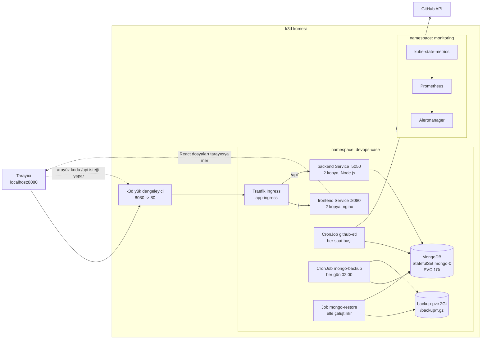
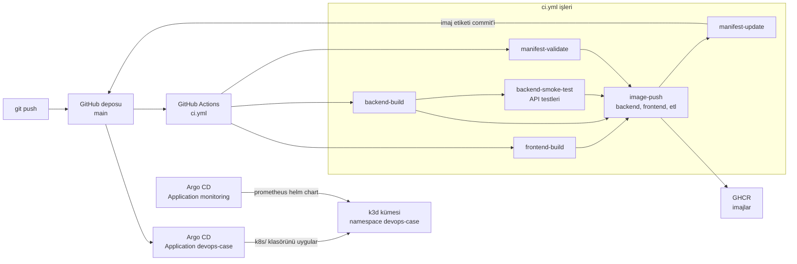

# Mimari

Uygulama yerel bir k3d kümesinde (tek düğüm) çalışır. Dağıtım GitOps ile yapılır: kümeye uygulanan her şey bu depodaki `k8s/` klasöründen gelir.

## 1. Çalışma zamanı

Düz oklar isteğin gittiği yönü, kesikli oklar arayüz dosyalarının tarayıcıya inişini ve ardından tarayıcıdaki arayüz kodunun yaptığı `/api` isteklerini gösterir. Frontend pod'ları backend'i kendileri çağırmaz, yalnızca statik dosya sunar. Backend çağrısını tarayıcı yapar ve bu çağrı yine Ingress'ten geçer.

| Bileşen | Görev |
| --- | --- |
| Traefik Ingress | `/api` isteklerini backend'e, geri kalanını frontend'e yönlendirir |
| frontend | React arayüzü, nginx ile sunulur, 2 kopya |
| backend | Express API, MongoDB'ye bağlanır, `/api/healthcheck` ile MongoDB'ye ping atar, 2 kopya |
| MongoDB | StatefulSet, kalıcı disk (PVC) üzerinde, tek kopya |
| github-etl | GitHub'dan repository bilgisini çekip MongoDB'ye `_id` ile upsert eder |
| mongo-backup | `mongodump` ile sıkıştırılmış yedek alır, arşivi `gzip -t` ile sınar, 7 günden eski yedekleri siler |
| mongo-restore | En yeni yedekten `mongorestore` çalıştırır, elle tetiklenir |
| Prometheus, Alertmanager | `EtlJobBasarisiz` ve `BackendHazirDegil` alarm kurallarını değerlendirir, alarmı gösterir (bildirim kanalı yok) |

Güvenlik: tüm uygulama konteynerleri root olmayan kullanıcıyla çalışır (backend 1000, frontend 101, MongoDB ve yedek işleri 999), yetkiler düşürülmüştür. Kullanıcı adı ve parola `app-secret` Secret'ında tutulur, depoda yoktur.

### Bir isteğin yolu

Kayıt listesini açan bir kullanıcının isteği şu yolu izler:

1. Tarayıcı `http://localhost:8080` adresine gider. Docker, bu portu k3d yük dengeleyicisinin 80 portuna bağlar.
2. Yük dengeleyici isteği Traefik Ingress'e iletir.
3. Yol `/` ise Ingress isteği `frontend` Service'ine (port 8080) yönlendirir, Service de iki frontend kopyasından birine dağıtır. nginx, React uygulamasının statik dosyalarını tarayıcıya gönderir. Arayüz kodu bundan sonra tarayıcıda çalışır.
4. Arayüz kayıtları almak için aynı adrese bağıl bir istek yapar, örneğin `/api/record/`. Yol `/api` ile başladığı için Ingress bu sefer isteği `backend` Service'ine (port 5050) yönlendirir, Service de iki backend kopyasından birine dağıtır.
5. Backend (Express) isteği doğrular (örneğin kayıt kimliği geçerli biçimde mi) ve MongoDB'ye `mongo` Service'i üzerinden (port 27017) bağlanıp kaydı okur ya da yazar.
6. Cevap aynı yoldan geri döner: MongoDB, backend, Ingress, tarayıcı. Backend her isteği zaman damgası, yöntem, yol, durum kodu ve süreyle loglar.

Backend kopyalarının hazır olup olmadığını Kubernetes `/api/healthcheck` ile sınar: bu uç MongoDB'ye ping atar, cevap vermezse 503 döner ve o kopya Service'ten çıkarılır. Böylece MongoDB erişilemezken istek bozuk bir backend'e gitmez.

### Dış erişim noktaları

| Erişim | Adres | Nasıl |
| --- | --- | --- |
| Uygulama (arayüz ve API) | `http://localhost:8080` | Kalıcı. Kümenin tek dışa açık HTTP noktası |
| Kubernetes API | `localhost:<rastgele port>` | `kubectl` için, kalıcı. k3d portu her kurulumda kendisi atar (`docker ps` çıktısında 6443'e bağlı port) |
| Argo CD arayüzü | `https://localhost:8090` | Yalnızca `kubectl port-forward` çalışırken |
| Prometheus, Alertmanager | `localhost:9090`, `localhost:9093` | Yalnızca `kubectl port-forward` çalışırken |

MongoDB ve backend yalnızca küme içinden erişilebilir (Service tipi `ClusterIP`), dışarıya açık değildir. Dışarıya giden bağlantılar: ETL'in GitHub API'sine istekleri ve kümenin GHCR'den imaj çekmesi.

## 2. Teslimat hattı (CI/CD ve GitOps)

1. Her push'ta CI frontend ve backend'i derler, backend'i gerçek bir MongoDB ile API testlerinden geçirir, `k8s/` dosyalarını doğrular.
2. Testler geçerse üç imaj (backend, frontend, etl) hem amd64 hem arm64 için üretilip GHCR'ye gönderilir, etiket olarak commit'in ilk 7 karakteri kullanılır.
3. `manifest-update` yeni etiketi `k8s/` dosyalarına yazıp `[skip ci]` ile commit eder (CI kendini tekrar tetiklemez).
4. Argo CD depodaki `k8s/` klasörünü izler ve değişikliği kümeye uygular. `selfHeal` açıktır: kümede elle yapılan değişiklikler git'teki hâline geri çevrilir. Bu yüzden geri alma (rollback) `kubectl rollout undo` ile değil, git'te `git revert` ile yapılır.
5. İzleme paketi (Prometheus) ayrı bir Argo CD uygulamasıyla helm chart olarak kurulur.

## 3. Bilinen sınırlamalar

Tek düğüm, tek MongoDB kopyası, yedeğin aynı kümede durması ve alarm bildirim kanalının olmaması bilinçli olarak kapsam dışı bırakıldı, ayrıntılar için bkz. [findings.md](findings.md).
